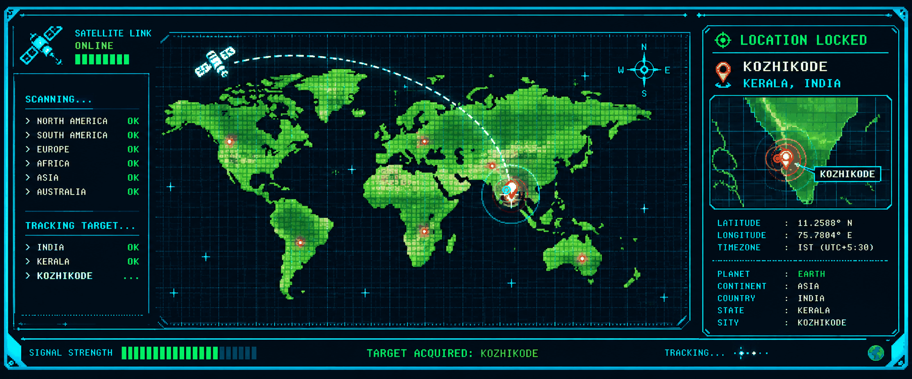
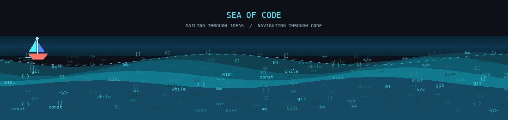

 

---

## About Me

I'm interested in how things work, how they're built, and how small ideas become useful products.

- Exploring software development and web technologies
- Building projects to put new concepts into practice
- Improving through experimentation and iteration

## Currently working on

---

## Tech stack

<table>
<tr>
<td align="center" width="25%" valign="top">

  

</td>
<td align="center" width="25%" valign="top">

  

</td>
<td align="center" width="25%" valign="top">

  

</td>
<td align="center" width="25%" valign="top">

  

</td>
</tr>
</table>

---

## GitHub activity

 

---

## Recent projects

<!-- AUTO-UPDATE:START -->
- [karthikm-ux](https://github.com/karthikm-ux/karthikm-ux) — My GitHub profile and projects · Updated 2026-10-30
- [Findora](https://github.com/karthikm-ux/Findora) · Updated 2026-10-22
- [Synode](https://github.com/karthikm-ux/Synode) · Updated 2026-07-26
- [Ayurvedic_AI_Agent-](https://github.com/karthikm-ux/Ayurvedic_AI_Agent-) — An AI-powered study assistant designed for Ayurvedic students. The project helps students learn Ayurvedic concepts, understand subjects more effectively, and prepare for exams through intelligent question answering, study support, and academic guidance. · Updated 2026-06-03
<!-- AUTO-UPDATE:END -->

Last updated: <!-- LAST-UPDATED -->2026-10-30<!-- /LAST-UPDATED -->

---

## Contributions

<picture>
  <source media="(prefers-color-scheme: dark)" srcset="https://raw.githubusercontent.com/karthikm-ux/karthikm-ux/output/pacman-contribution-graph-dark.svg" />
  <source media="(prefers-color-scheme: light)" srcset="https://raw.githubusercontent.com/karthikm-ux/karthikm-ux/output/pacman-contribution-graph.svg" />
  
</picture>

 

KOZHIKODE · KERALA · INDIA

---

## Find me elsewhere

---

 

