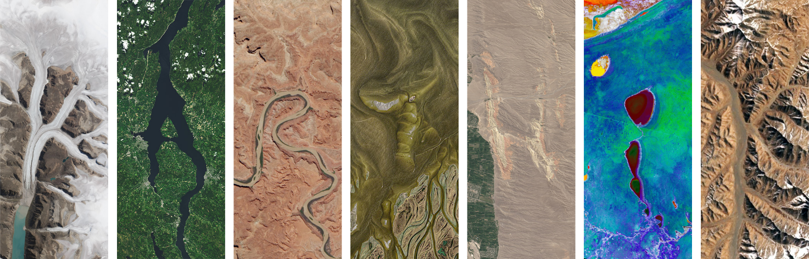

 <!--
  GITHUB PROFILE README
  Theme: Midnight Navy / Neon Cyan / Electric Blue / Coral
  Profile: karthikm-ux
-->

  

   

  

   

  
  
  

---

## 

- Exploring the intersection of technology, creativity, and problem-solving.
- Building projects to turn ideas into practical digital experiences.
- Learning new tools and improving through experimentation.
- Interested in software development, modern web technologies, and design.

---

## 

---

## 

| SYSTEM | CURRENT STATE |
|:---|:---|
| Learning | `IN PROGRESS` |
| Building | `ACTIVE` |
| Experimenting | `ONGOING` |
| Improving | `CONTINUOUS` |

---

## 

### 

  

### 

  

### 

  

### 

  

---

## 

| AREA | DIRECTION |
|:---|:---|
| Development | Building and refining projects |
| Design | Creating clear digital experiences |
| Technology | Exploring new tools and workflows |
| Problem Solving | Learning through practice |

---

## 

 

---

## 

<!-- AUTO-UPDATE:START -->
*Repository list will appear after the GitHub Actions workflow runs.*
<!-- AUTO-UPDATE:END -->

  Last updated: <!-- LAST-UPDATED -->pending first run<!-- /LAST-UPDATED -->

---

## 

<picture>
  <source media="(prefers-color-scheme: dark)" srcset="https://raw.githubusercontent.com/karthikm-ux/karthikm-ux/output/pacman-contribution-graph-dark.svg" />
  <source media="(prefers-color-scheme: light)" srcset="https://raw.githubusercontent.com/karthikm-ux/karthikm-ux/output/pacman-contribution-graph.svg" />
  
</picture>

---

## 

---

<!-- SEA OF CODE FOOTER -->

 

  <code>01001000 01001001</code> &nbsp; ⛵ &nbsp; <code>01000011 01001111 01000100 01000101</code>

  SAILING THROUGH IDEAS · NAVIGATING THROUGH CODE

